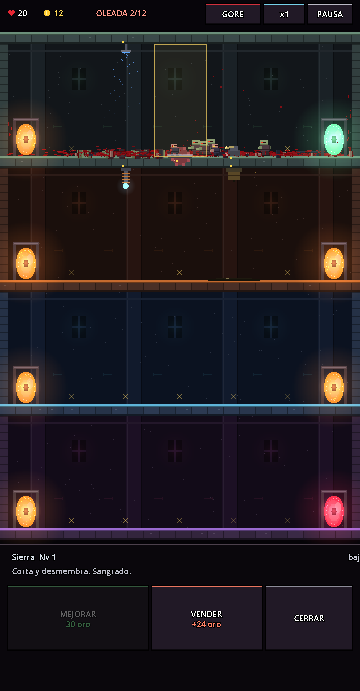
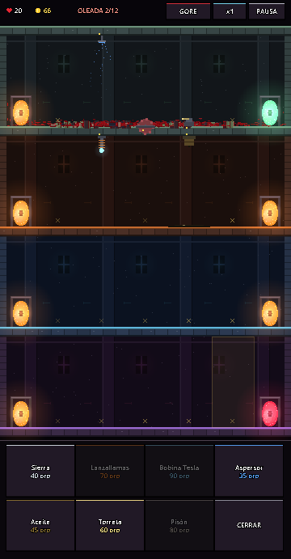

# PortalKill

**Tower defense vertical para celular.** Las hordas entran por el portal de la cima, recorren cada piso en zigzag y bajan por los portales. Tú colocas **trampas elementales** que se combinan entre sí. Gore opcional (+18).

- 🎮 **Jugar (iPhone/Android/PC):** https://marlon19991.github.io/portalkill/. En iPhone: Safari → Compartir → *Agregar a inicio* para pantalla completa.
- Diseño, arquitectura y hoja de ruta: [docs/DISENO.md](docs/DISENO.md)
- Motor: **Godot 4.7.2** (GDScript, renderer Compatibility/WebGL2)

 

## Cómo se juega
- Toca una **X** para construir: Sierra, Lanzallamas, Bobina Tesla, Aspersor, Aceite, Torreta o Pisón.
- Toca una trampa para **mejorarla** (3 niveles) o **venderla**.
- **INICIAR OLEADA** antes de tiempo da oro extra. Hay 12 oleadas; si un enemigo llega al portal rojo, pierdes vidas.
- **Combos:** Aspersor → Tesla (cadena x2) · Aceite → Lanzallamas (NAPALM) · Sierra desmembra · Pisón empuja hacia atrás.

## Ejecutar en la Mac

```bash
~/Applications/Godot.app/Contents/MacOS/Godot --path .
```

Usa la versión estándar de Godot, no Godot_mono.

## Publicar una versión nueva en el iPhone

```bash
./tools/publish_web.sh
```

El script exporta el build Web y lo sube a la rama `gh-pages`. En 1–2 minutos aparece en el mismo link.

## Pruebas automáticas (bot)

```bash
~/Applications/Godot.app/Contents/MacOS/Godot --headless --path . -- --autotest --duration=1500 --timescale=6
```

Opciones después de `--`: `--autotest`, `--duration=S`, `--timescale=N`, `--stress`, `--gore=0|1|2`, `--shots=DIR`, `--shotevery=S`, `--panel=build|trap` (las capturas requieren ventana, sin `--headless`).

El prototipo anterior (arena de plataformas) quedó en el tag `arena-prototype`.
