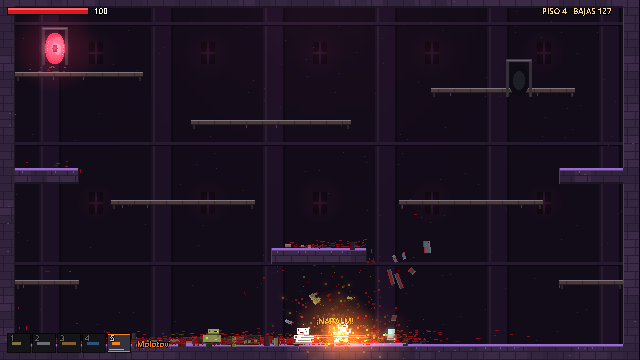

# PortalKill

Arena de plataformas por pisos: hordas salen del portal de entrada, las eliminas con armas elementales que se combinan y cruzas el portal de salida al siguiente piso. Gore opcional (+18).

- Diseño, arquitectura y hoja de ruta: [docs/DISENO.md](docs/DISENO.md)
- Motor: **Godot 4.7** (GDScript, renderer Compatibility → PC + Web)



## Ejecutar

Abre la carpeta con Godot 4.7 (versión **estándar**, no .NET) y presiona F5, o desde la terminal:

```bash
~/Applications/Godot.app/Contents/MacOS/Godot --path .
```

## Controles

| Acción | Teclado/ratón | Mando |
|---|---|---|
| Moverse | A/D | Stick izquierdo |
| Saltar | W / Espacio | A |
| Bajar plataforma | S + Saltar | Abajo + A |
| Apuntar / disparar | Ratón / clic izquierdo | Stick derecho / RT |
| Cambiar arma | 1–6, Q/E, rueda | LB/RB |
| Pausa · Gore · Rendimiento | Esc · G · F3 | Start · Select |

## Pruebas automáticas (bot)

El juego trae un bot que juega solo, imprime métricas y toma capturas:

```bash
~/Applications/Godot.app/Contents/MacOS/Godot --headless --path . -- --autotest --duration=300 --timescale=5
```

Opciones después de `--`: `--autotest`, `--duration=S`, `--timescale=N`, `--stress` (≈100 enemigos), `--gore=0|1|2`, `--shots=DIR`, `--shotevery=S` (las capturas requieren ventana, sin `--headless`).

Resultados medidos (Mac Apple Silicon): 5 pisos sin errores; en modo estrés con más de 100 enemigos y unas 1800 gotas de sangre, unos 120 FPS de promedio (tope de vsync).

## Distribuir

1. En Godot: *Editor → Administrar plantillas de exportación → Descargar*.
2. *Proyecto → Exportar*: agrega **Web**, **Windows**, **Linux** y **macOS**.
3. **itch.io** (gratis): sube el build Web como HTML5 (marca "SharedArrayBuffer" si lo pide) y los builds de escritorio con [butler](https://itch.io/docs/butler/). Marca el contenido como adulto.
4. **Steam**: pago único de USD 100 por juego, más el cuestionario de contenido maduro.
